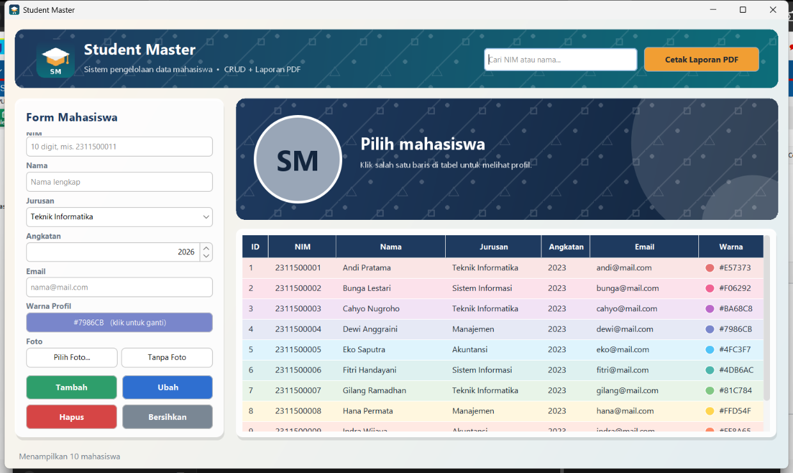
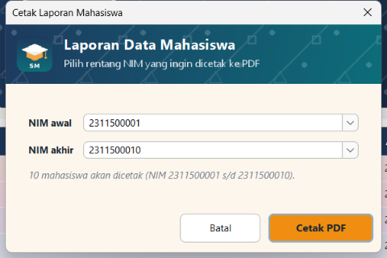
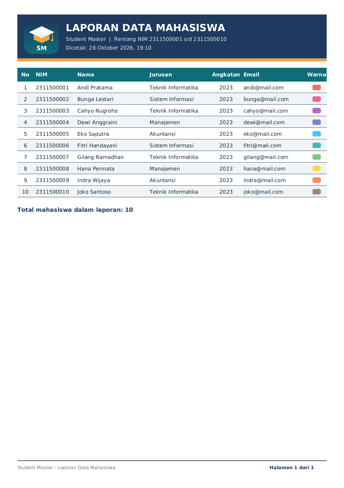

# Student Master

Aplikasi desktop **Java Swing** untuk mengelola data mahasiswa (CRUD) yang tersimpan di **MySQL**, lengkap dengan **laporan PDF JasperReports**.



## Fitur

| Kebutuhan tugas | Implementasi |
|---|---|
| CRUD berjalan lancar | Tambah, lihat/cari, ubah, hapus data mahasiswa di MySQL (`StudentDAO`, `PreparedStatement`) dengan validasi input |
| UI rapi dengan warna & gambar latar | Header gradasi + gambar motif (`pattern.png`) + logo, latar jendela bergradasi, tema FlatLaf |
| Tampilan berbeda tiap mahasiswa | Kartu profil memakai warna khas (`warna`) dan foto (`foto`) masing-masing; baris tabel diwarnai sesuai warna mahasiswa |
| Laporan JasperReports | `src/main/resources/reports/student_report.jrxml` |
| Logo di header laporan | Parameter `LOGO` di band *Page Header* |
| Nomor & jumlah halaman di footer | "Halaman X dari Y" (`$V{PAGE_NUMBER}` + `evaluationTime="Report"`) |
| Form rentang NIM | `ReportDialog` (NIM awal & akhir) &rarr; query `WHERE nim BETWEEN $P{NIM_AWAL} AND $P{NIM_AKHIR}` |
| Output PDF | Disimpan di folder `reports/` |
| Capture tiap aksi | Otomatis tersimpan di folder `captures/` |

## Teknologi

- Java 17+ (diuji dengan Eclipse Temurin 25), Maven
- MySQL 8 + MySQL Connector/J 8.4
- JasperReports 6.21.3 (+ jasperreports-fonts)
- FlatLaf 3.5.4

## Struktur Proyek

```
student-master/
├── captures/                 # screenshot setiap aksi CRUD & laporan (.png)
├── database/
│   └── db_student_master.sql # skrip pembuatan database + data contoh
├── reports/                  # hasil laporan PDF
├── src/main/java/com/ucup/
│   ├── Main.java             # titik awal program
│   └── studentmaster/
│       ├── model/Student.java
│       ├── db/DBConnection.java
│       ├── dao/StudentDAO.java
│       ├── report/StudentReport.java
│       ├── ui/               # MainFrame, ReportDialog, ProfileCard, Theme, ...
│       └── TestCRUD.java     # uji CRUD lewat console
└── src/main/resources/
    ├── db.properties.example
    ├── images/               # logo.png, pattern.png
    └── reports/student_report.jrxml
```

## Cara Menjalankan

1. **Buat database**: jalankan `database/db_student_master.sql` di MySQL Workbench.
2. **Atur koneksi**: salin `src/main/resources/db.properties.example` menjadi `db.properties`, lalu isi password MySQL.
3. Buka proyek di **IntelliJ IDEA**, klik *Load Maven Changes*.
4. Jalankan `com.ucup.Main`.

## Cara Mencetak Laporan

1. Klik tombol **Cetak Laporan PDF** di kanan atas.
2. Pilih atau ketik **NIM awal** dan **NIM akhir**.
3. Klik **Cetak PDF**. File tersimpan di `reports/` dan langsung dibuka.

## Screenshot

| Aksi | File |
|---|---|
| Read (tampil data) | `captures/read.png` |
| Create (tambah) | `captures/create.png` |
| Update (ubah) | `captures/update.png` |
| Delete (hapus) | `captures/delete.png` |
| Form rentang NIM | `captures/report_form.png` |
| Hasil laporan PDF | `captures/report_pdf.png` |




